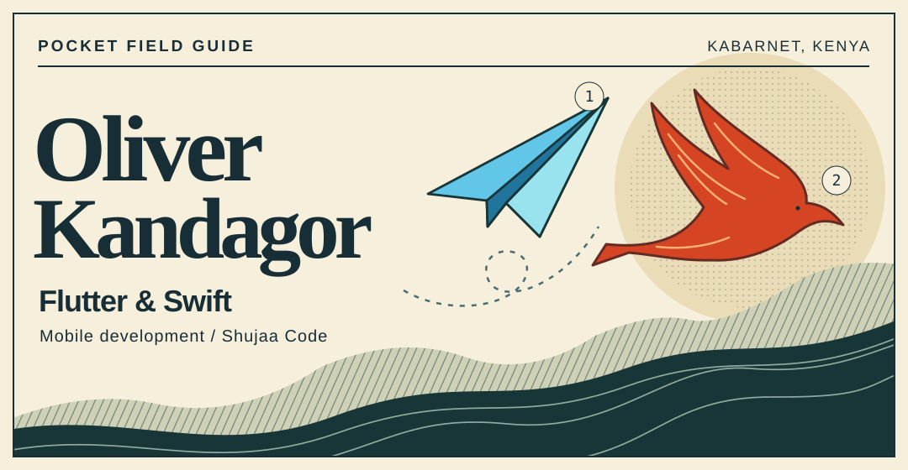

I’m Oliver. I run **Shujaa Code** in Kenya, where I build mobile tools for schools and businesses. Two things I pay attention to: what happens when the signal drops, and whether a screen remembers where you were.

### ① Flutter · The fold

**[Nifunze](https://github.com/oliver-kandagor/nifunze-app)** turns studying into a game. **[CampusMart](https://github.com/oliver-kandagor/campusmart-app)** gives university students a place to buy and sell. For a smaller piece you can pick up and use, take a look at **[Liquid Tab Bar](https://github.com/oliver-kandagor/liquid_tab_bar)**, a floating navigation bar for Flutter.

### ② Swift · The bird

**[MoodleConnect for iOS](https://github.com/oliver-kandagor/MoodleConnect-iOS)** puts Moodle courses and grades into a native SwiftUI app. One detail worth opening the code for: switch from courses to grades and back, and the course screen keeps its place instead of fetching everything again.

**Have a mobile project in mind?** [Email me](mailto:oliverkandagor1@gmail.com) · [Find me on LinkedIn](https://www.linkedin.com/in/oliver-kandagor)
