<!-- Hero: custom artwork, switches with GitHub light/dark theme -->
<a href="https://github.com/oliver-kandagor">
  <picture>
    <source media="(prefers-color-scheme: dark)" srcset="./assets/hero-dark.svg">
    <source media="(prefers-color-scheme: light)" srcset="./assets/hero-light.svg">
    
  </picture>
</a>

> **Android developer building mobile-first products with Flutter and Swift.**
> I care about apps that open instantly, work offline, and keep your data on your device.
> Founder of **Shujaa Code**, where I build mobile apps and digital tools for schools and businesses in Kenya.

## 👋 A little about me

- 🔭 **Currently building:** learning apps for students and African languages, and privacy-first money apps
- 🤖 **Android first:** native with Kotlin + Jetpack Compose, cross-platform with Flutter
- 🍎 **Also on iOS:** Swift and SwiftUI when an app needs to feel truly native
- 🌍 **Open source:** I fork, study and contribute to Flutter, Dart and Matrix projects
- 💬 **Ask me about:** offline-first architecture, Flutter UI and animations, Material 3 design systems

## 🧰 Tech stack

<table>
<tr>
<td><b>Core</b></td>
<td>

</td>
</tr>
<tr>
<td><b>Native Android</b></td>
<td>

</td>
</tr>
<tr>
<td><b>Data & tools</b></td>
<td>

</td>
</tr>
</table>

## 📱 Apps I'm proud of

| App | What it does | Built with |
| --- | --- | --- |
| 🧾 **[MemoBill](https://github.com/oliver-kandagor/memobill)** | Offline bills tracker and smart shopping list. Your data never leaves the phone. | Kotlin · Jetpack Compose |
| 📘 **[Nifunze](https://github.com/oliver-kandagor/nifunze-app)** | Interactive learning app that makes studying feel like a game | Flutter · Dart |
| 🛒 **[CampusMart](https://github.com/oliver-kandagor/campusmart-app)** | Marketplace where university students buy and sell to each other | Flutter · Dart |
| 🫧 **[Liquid Tab Bar](https://github.com/oliver-kandagor/liquid_tab_bar)** | Floating liquid-glass tab bars for Flutter apps | Flutter |
| 🎨 **[Flutter UI Kit](https://github.com/oliver-kandagor/flutter_ui_kit_obkm)** | 100+ ready-to-use mobile screens to start apps faster | Flutter |
| 🗣️ **[Kalenjin TTS](https://github.com/oliver-kandagor/Kalenjin-TTS-V1)** | Text-to-speech for the Kalenjin language, bringing local languages to mobile | Speech AI |

## 🌍 Open source I work with

| Area | Projects |
| --- | --- |
| 💙 Flutter & Dart | [fl_chart](https://github.com/oliver-kandagor/fl_chart) · [flutter_chat_ui](https://github.com/oliver-kandagor/flutter_chat_ui) · [matrix-dart-sdk](https://github.com/oliver-kandagor/matrix-dart-sdk) · [Cashew](https://github.com/oliver-kandagor/Cashew) · [pangolin_desktop](https://github.com/oliver-kandagor/pangolin_desktop) |
| 🍎 iOS & Swift | [Squirrel](https://github.com/oliver-kandagor/Squirrel) · [MoodleConnect-iOS](https://github.com/oliver-kandagor/MoodleConnect-iOS) |
| 💬 Messaging | [synapse](https://github.com/oliver-kandagor/synapse) · [Rocket.Chat](https://github.com/oliver-kandagor/Rocket.Chat) · [ouk-web](https://github.com/oliver-kandagor/ouk-web) |
| 🔐 Privacy-first tools | [aula](https://github.com/oliver-kandagor/aula) · [finvo](https://github.com/oliver-kandagor/finvo) · [rekody](https://github.com/oliver-kandagor/rekody) · [Kanda-CV](https://github.com/oliver-kandagor/Kanda-CV) |

> Maintainers: if your issue needs Flutter, Android or iOS help, feel free to tag **@oliver-kandagor**.

## 🔥 Activity

<picture>
  <source media="(prefers-color-scheme: dark)" srcset="https://streak-stats.demolab.com/?user=oliver-kandagor&theme=github-dark-blue&hide_border=true&background=0D111700&ring=3DDC84&fire=F05138&currStreakLabel=3DDC84">
  
</picture>

  

<picture>
  <source media="(prefers-color-scheme: dark)" srcset="https://raw.githubusercontent.com/oliver-kandagor/oliver-kandagor/output/snake-dark.svg">
  
</picture>

## 🤝 Let's build something

I'm open to **Android, Flutter and iOS roles**, freelance mobile projects, and open-source collaboration.
The fastest way to reach me is **[oliverkandagor1@gmail.com](mailto:oliverkandagor1@gmail.com)**.
