

  &nbsp;
  <a href="#swift-studio"></a>&nbsp;
  &nbsp;
  

  

I build mobile apps and tools through **Shujaa Code**. Most days, that means Flutter and Dart; when an app should feel at home on iPhone, Swift and SwiftUI. I care about the details that matter after launch: fast screens, useful offline behavior, and interfaces that feel considered.

## Flutter lab

<a href="https://github.com/oliver-kandagor/liquid_tab_bar">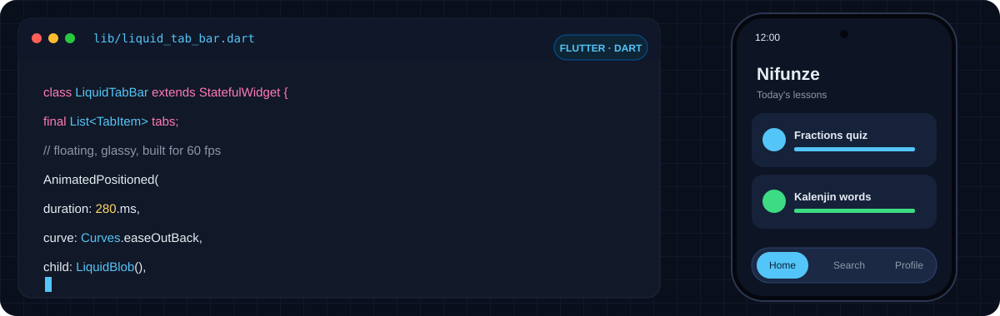</a>

A cross-platform toolkit for ideas that should feel good in the hand. The illustration above pairs a small slice of Flutter code with an Android learning screen.

<table>
  <tr>
    <td><a href="https://github.com/oliver-kandagor/liquid_tab_bar"></a></td>
    <td><a href="https://github.com/oliver-kandagor/nifunze-app"></a></td>
  </tr>
  <tr>
    <td><a href="https://github.com/oliver-kandagor/campusmart-app"></a></td>
    <td><a href="https://github.com/oliver-kandagor/flutter_ui_kit_obkm"></a></td>
  </tr>
</table>

## Swift studio

<a href="https://github.com/oliver-kandagor/MoodleConnect-iOS">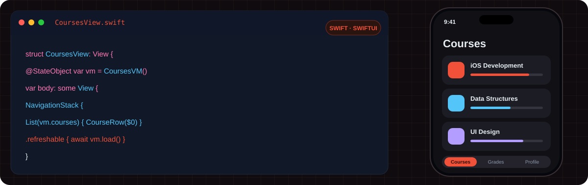</a>

For **MoodleConnect iOS**, I used SwiftUI for a native courses and grades experience, with MVVM and async/await behind it. The screen keeps its state when you move between tabs. I also work on iOS projects like [Squirrel](https://github.com/oliver-kandagor/Squirrel).

<a href="https://github.com/oliver-kandagor/MoodleConnect-iOS"></a>

## Android, built to work offline

<a href="https://github.com/oliver-kandagor/memobill"></a>

## Open source

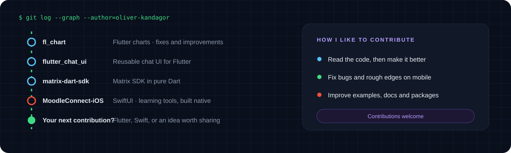

I like learning in public: reading the code, improving the edges, and sharing what I learn. Some of the projects I spend time around:

- **Flutter and Dart:** [fl_chart](https://github.com/oliver-kandagor/fl_chart) · [flutter_chat_ui](https://github.com/oliver-kandagor/flutter_chat_ui) · [matrix-dart-sdk](https://github.com/oliver-kandagor/matrix-dart-sdk) · [Cashew](https://github.com/oliver-kandagor/Cashew)
- **Swift and iOS:** [MoodleConnect-iOS](https://github.com/oliver-kandagor/MoodleConnect-iOS) · [Squirrel](https://github.com/oliver-kandagor/Squirrel)
- **Privacy-first tools:** [aula](https://github.com/oliver-kandagor/aula) · [finvo](https://github.com/oliver-kandagor/finvo) · [rekody](https://github.com/oliver-kandagor/rekody)

## Commit log

  <picture>
    <source media="(prefers-color-scheme: dark)" srcset="https://raw.githubusercontent.com/oliver-kandagor/oliver-kandagor/output/snake-dark.svg" />
    
  </picture>

## Contact

<a href="mailto:oliverkandagor1@gmail.com">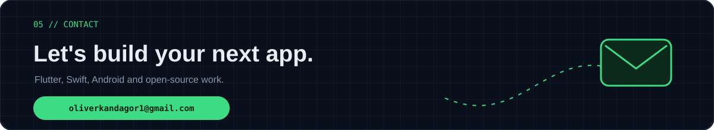</a>

